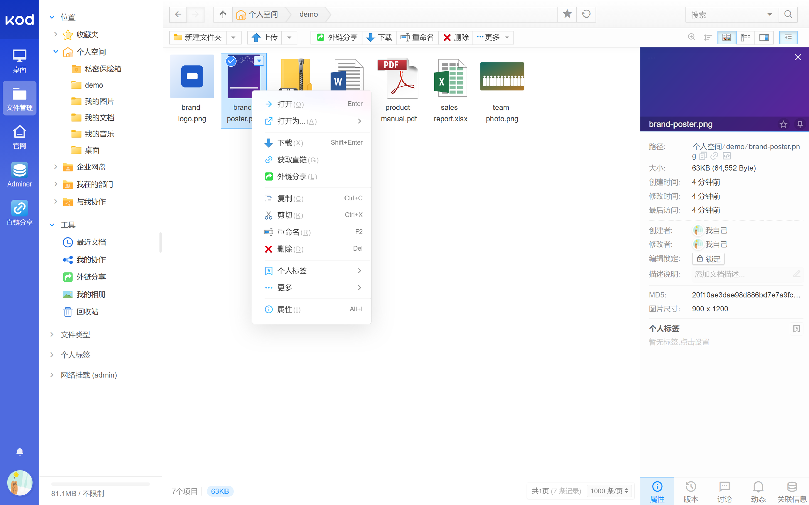
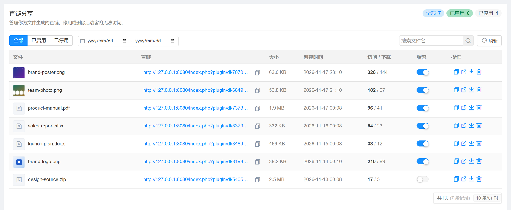
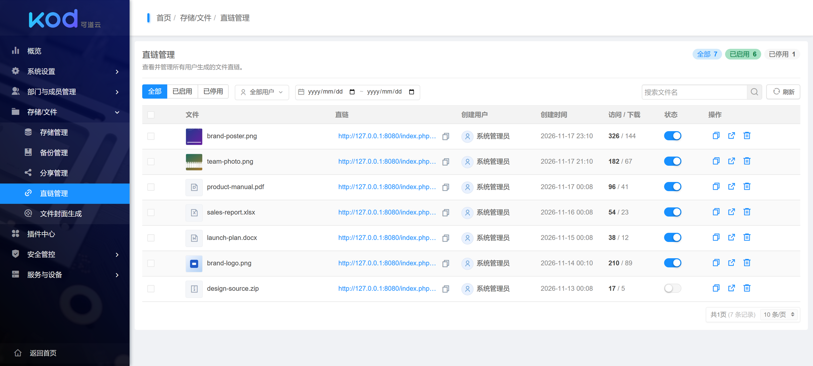

# 直链分享（dl）· kodbox 插件

为 kodbox 中的文件生成**永久、可随时停用、访客无需登录即可访问**的直链。

链接形如：

```text
https://your-host/index.php?plugin/dl/3f9k2m8q1x7p
```

直链不占用分享名额，不随分享过期或密码变更失效；只要创建者仍拥有该文件的下载权限，链接就一直可用。文件重命名、移动目录后链接保持不变，访问时会自动同步最新的文件名和大小。

> English: **Direct Links (dl)** is a [kodbox](https://github.com/kalcaddle/kodbox) plugin that creates permanent, revocable direct links for files. Guests can download without an account. A link stays valid only while its creator still has download permission for the file. See the Chinese documentation below for installation and configuration.

---

## 功能亮点

- **匿名直链**：访客无需登录即可访问，适合图片外链、音视频嵌入、下载分发。
- **随时停用**：每条直链都有独立开关，停用后立即 404。
- **永久有效**：不随分享有效期、密码、分享删除而失效；创建者权限被收回、账号被禁用时自动失效。
- **同文件复用**：同一用户对同一文件重复获取时返回已有直链，不会产生重复记录。
- **多选批量获取**：文件列表多选后一次生成多条直链，并发请求受控。
- **文件状态同步**：文件重命名/移动后链接继续可用，名称和大小自动更新；进入回收站后链接失效且从列表隐藏，还原后自动恢复。
- **管理页**：顶部菜单「直链分享」集中查看、复制、打开、下载、启停、删除自己的直链。
- **后台管理**：管理员可查看所有用户的直链，按用户、状态、文件名、日期筛选，支持单条/批量删除。
- **浏览器缓存**：直链响应不声明显式缓存指令（`Cache-Control`），只提供 `ETag`/`Last-Modified`，由浏览器按 RFC 7234 启发式缓存；首次请求返回 200 及文件，缓存过期后回源校验，未变化时返回 304。
- **安全设计**：强制下载可执行类型、失败访问限频、CSRF 校验、封面鉴权、输出转义。

---

## 界面截图

### 文件右键获取直链

在文件列表右键文件或选中多个文件后右键，选择「获取直链」。



### 用户直链管理

顶部菜单「直链分享」：查看访问/下载统计、复制、打开、下载、启停和删除自己的直链。



### 后台直链管理

管理员在「存储/文件 → 直链管理」中查看所有用户的直链，支持用户/状态/日期筛选和批量删除。



> 截图中的文件与数据均为演示数据。

## 兼容性

| 项目 | 说明 |
| --- | --- |
| kodbox | 1.71.04 实测通过（1.71 系列） |
| PHP | 7.4 实测通过，代码兼容 PHP 8.x |
| 数据库 | MySQL 已实测；SQLite 建表脚本已验证（未切换整站数据库运行） |
| 浏览器 | Chrome / Edge / Firefox 等现代浏览器 |

插件首次使用时会自动创建 `plugin_dl` 数据表（MySQL/SQLite 自动识别），无需手工导入 SQL。

---

## 安装

1. 将插件放入 kodbox 的插件目录，目录名必须为 `dl`。两种方式任选：

   - **下载安装包**：从 [Releases](https://github.com/litxiaoxi/kodbox-plugin-directLink/releases) 下载 `dl-1.0.5.zip`，解压后得到 `dl` 目录，把整个 `dl` 目录放入 kodbox 的 `plugins/` 下。
   - **克隆仓库**（必须指定目录名为 `dl`）：

   ```bash
   cd /path/to/kodbox/plugins
   git clone https://github.com/litxiaoxi/kodbox-plugin-directLink.git dl
   ```

   注意：GitHub 自动生成的 Source code (zip) 解压后目录名是仓库名（如 `kodbox-plugin-directLink-1.0.5`），不能直接作为插件目录使用，请使用上面的安装包，或克隆后把目录重命名为 `dl`。

2. 登录 kodbox → **后台管理 → 插件中心**，找到「直链分享」并启用。
3. 打开插件配置，确认「使用权限」为 **所有用户**（否则匿名访客无法访问直链）。
4. 刷新页面，文件右键菜单中出现「获取直链」，顶部菜单出现「直链分享」。

> 如果数据库账号没有建表权限，可手动导入 `lib/data/plugin_dl.sql`（MySQL）或 `lib/data/plugin_dl.sqlite.sql`（SQLite）。

---

## 使用

### 普通用户

- **获取直链**：在文件管理器中右键文件（或选中多个文件后右键）→「获取直链」，链接会自动复制到剪贴板。
- **管理直链**：顶部菜单「直链分享」。
  - 支持按文件名搜索、按启用/停用筛选、按创建日期筛选。
  - 可复制、打开、下载、启用/停用、删除单条直链。
  - 点击文件名可在资源管理器中定位文件。
- **仅支持文件**：文件夹、分享内容（外链分享、协作分享、收到的分享）不能生成匿名直链。

### 管理员

后台 **存储/文件 → 直链管理**（位于「分享管理」之后）：

- 查看所有用户的直链，统计总数、启用数、停用数。
- 按用户、状态、文件名、创建日期筛选。
- 启用/停用、单条删除、勾选后批量删除。
- 点击文件名定位文件，点击用户可筛选该用户的直链。

---

## 插件配置

| 配置项 | 可选值 | 默认值 | 说明 |
| --- | --- | --- | --- |
| 使用权限 | 用户选择器 | 所有用户 | 保持「所有用户」，匿名访客才能访问直链 |
| 打开样式 | 嵌入页面 / 对话框 / 新窗口 | 嵌入页面 | 顶部菜单「直链分享」的打开方式 |
| 是否添加到主菜单 | 开 / 关 | 开 | 关闭后仍可通过 `plugin/dl/index` 访问管理页 |
| 子菜单 | 开 / 关 | 关 | 主菜单二级分组显示 |
| 直链字符类型 | 纯数字 / 小写字母+数字 / 大小写字母+数字 | 小写字母+数字 | 仅影响新生成的直链 |
| 直链字符长度 | 6–32 | 12 | 纯数字类型最少 8 位 |

> 纯数字 8 位只有 1 亿种组合，仍建议使用默认的 12 位混合字符。插件对失败访问做了限频（同一 IP 5 分钟内最多 120 次失败），进一步降低枚举风险。

---

## 链接规则

- 标准形式：`index.php?plugin/dl/<token>`
- 开启伪静态后同样可用：`index.php/plugin/dl/<token>`、`/?plugin/dl/<token>`。
- `token` 由 `[0-9A-Za-z_-]` 组成，长度 4–64；实际生成长度由插件配置决定。
- 追加 `&download=1` 可强制下载（前端「下载」按钮即使用该参数）。
- 为防止匿名直链在本站域内执行脚本，以下类型**始终强制下载**：
  `html/htm/xhtml/xht/shtml/shtm/svg/xml/xsl/xslt/js/mjs/swf/hta/mht/mhtml`。
- 响应头包含 `X-Content-Type-Options: nosniff`、`ETag`、`Last-Modified`，**不输出** `Cache-Control`/`Pragma`/`Expires`。
  浏览器按 RFC 7234 的启发式规则（通常取“距最后修改时间的一定比例”，如 10%）决定本地新鲜期：
  新鲜期内直接使用本地副本、不产生请求；过期后回源校验，文件未变化返回 `304 Not Modified`（不传输正文、不计访问量）。
  直链停用、创建者权限收回或文件删除后，服务端立即返回 404；但浏览器中仍处于启发式新鲜期的副本在过期回源前可能继续展示。

---

## 安全设计

- **权限实时校验**：每次回源访问直链都会按创建者身份重新校验文件下载权限；创建者被禁用、删除、移出部门或角色权限被收回后，直链立即失效。
  注意：浏览器按 RFC 7234 启发式缓存，本地新鲜期内的请求不会回源，已缓存的副本会在该期限内继续可读。
- **分享内容隔离**：外链分享、协作分享、收到的分享等路径不允许生成匿名直链，避免绕过分享密码、有效期和权限。
- **匿名访问限频**：无效 token、已停用直链、创建者无权限的访问按 IP 限频，超过阈值返回 `429` 并带 `Retry-After`。
- **CSRF 防护**：创建、启停、删除接口校验 `CSRF_TOKEN`；使用 `accessToken` 的 API 调用与核心规则一致地跳过。
- **封面鉴权**：封面接口仅登录用户可访问，普通用户只能查看自己的直链封面，管理员可查看全部；SVG 不作为封面内联输出，避免存储型 XSS。
- **输出转义**：文件名、URL、错误信息在服务端和前端均做转义；404 页面使用静态 HTML。
- **物理路径限制**：物理/IO 路径直链仅管理员可用，并受 `ADMIN_ALLOW_IO`、`ADMIN_ALLOW_SOURCE` 配置约束。

> **注意**：插件依赖 kodbox 的插件权限机制。如果把「使用权限」限制为部分用户，匿名直链将无法访问（匿名请求也需要通过插件权限校验）。此场景下请通过其他方式控制访问。

---

## 常见问题

**Q：直链打不开，返回 404？**

依次检查：

1. 插件是否已启用；
2. 直链是否被停用或删除；
3. 文件是否在回收站或已彻底删除；
4. 创建者是否仍有该文件的下载权限、账号是否被禁用；
5. 插件「使用权限」是否包含匿名访问所需的「所有用户」；
6. 链接 token 是否完整（不要漏掉字符）。

**Q：链接会过期吗？**

不会按时间过期。链接会因停用、删除、文件删除或创建者失去下载权限而失效。

**Q：文件重命名/移动后链接还能用吗？**

可以。直链绑定的是文件的 source ID，不依赖文件名或目录；访问时会自动同步新的文件名和大小。

**Q：文件进回收站后链接会怎样？**

直链立即失效，并从用户/后台列表中隐藏；还原文件后自动恢复显示和访问。彻底删除文件的直链同样隐藏，但数据库记录保留（列表接口只读，不自动删除记录）。

**Q：同一文件重复获取会生成多条直链吗？**

不会。同一用户、同一文件会复用已有直链；如果已有直链被停用，返回的仍是该直链（`status=0`），前端会提示「直链已停用」。

**Q：支持文件夹吗？**

不支持。匿名直链只针对单个文件；文件夹请使用 kodbox 自带的分享或打包下载功能。

**Q：删除直链会删除文件吗？**

不会。删除的只是直链记录，原文件不受影响。

---

## 目录结构

```text
plugins/dl/
├── app.php                     # 插件入口：路由接管、文件输出、管理接口
├── package.json                # 插件元数据与配置表单
├── README.md
├── CHANGELOG.md
├── TESTING.md                  # 测试记录
├── LICENSE                     # GPLv3
├── screenshots/                # README 界面截图
├── i18n/
│   ├── zh-CN.php
│   └── en.php
├── lib/data/
│   ├── plugin_dl.sql           # MySQL 建表脚本（首次使用自动执行）
│   └── plugin_dl.sqlite.sql    # SQLite 建表脚本
└── static/
    ├── main.js                 # 主界面注入：菜单、右键菜单、复制直链
    ├── page.html / page.js / page.css   # 用户直链管理页（iframe）
    └── admin/index.js / index.css       # 后台直链管理页
```

---

## 开发说明

- 无构建步骤：`static/` 下是可直接阅读、修改的普通 JS/CSS。
- 调试：将 `config/config.php` 中的 `GLOBAL_DEBUG` 改为 `1`，可输出错误与调用栈。
- 修改 `static/` 后如页面未更新，可在后台清理缓存，或直接刷新页面（JS/CSS 带版本参数）。
- 新增接口方法后，路由会自动把方法名加入保留字列表，避免与直链 token 冲突。
- 新增对外方法时需确认 `config/setting.php` 中的 `plugin.*` 已放行（kodbox 对插件路由单独做权限检测）。

---

## 更新日志

见 [CHANGELOG.md](CHANGELOG.md)。

## 测试

功能与边界测试记录见 [TESTING.md](TESTING.md)。

## License

[GNU General Public License v3.0](https://www.gnu.org/licenses/gpl-3.0.txt)，与 [kodbox](https://github.com/kalcaddle/kodbox) 保持一致。

## 作者

Litx · <http://litx.cn>